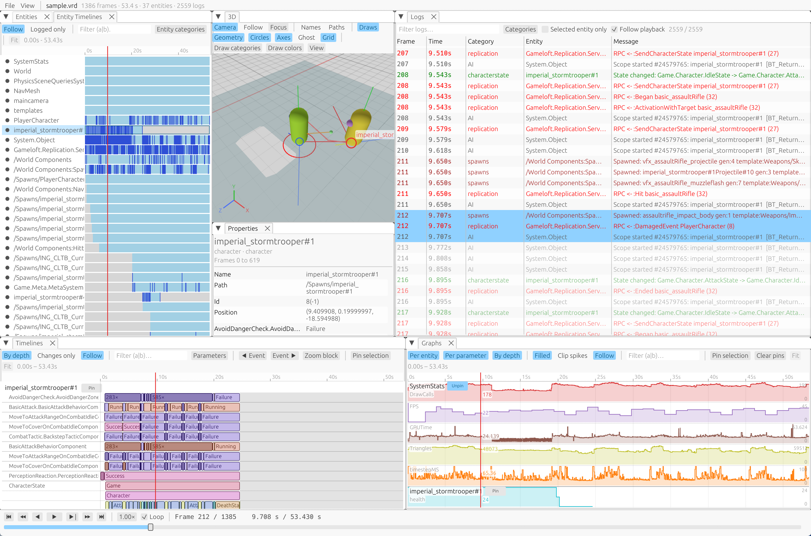

# VisualReplayDebuggerCraft

A rewrite of [VisualReplayDebugger](https://github.com/gitdonohue/VisualReplayDebugger) in Rust, in the spirit of
[SolidCraft](https://github.com/tangency-labs/solidcraft): one codebase, a cross-platform UI, and it runs both as
a desktop app and in the browser.

VisualReplayDebugger is an engine-agnostic visual replay debugging tool for game and AI development. Your game
records entities, positions, logs, parameters and debug draws into a `.vrd` capture, and the tool lets you scrub
back and forth through it. Existing `.vrd` captures open unchanged.



## Status

Early. Working today: opening captures (including truncated ones), the entity tree, a filterable log view,
entity properties over time, playback controls, a 3D wgpu viewport (entity geometry, debug draws, paths, picking, follow-camera), and graphs
of recorded values over time, timelines of text parameters, entity timelines (when each entity lived and logged), and dockable panels (several graphs and timelines views, panels can move to their own windows). It runs on desktop and in the browser. There is also an [MCP server](docs/mcp.md) so AI assistants can read and analyse captures, and the web version offers the same tools, plus ones that drive the view, to a browser's assistant through [WebMCP](docs/webmcp.md).

## Try it

**[Open the web version](https://gitdonohue.github.io/VisualReplayDebuggerCraft/?url=sample.vrd)** (a sample capture is loaded; drop your own `.vrd` onto the page to open it). It needs a browser with WebGPU or WebGL2.

## Run it

```
cargo run -p vrd -- testdata/sample.vrd          # desktop
cd apps/vrd-web && trunk serve                   # browser; open /?url=sample.vrd
cargo run -p vrd-cli -- info testdata/sample.vrd # inspect a capture
cargo run -p vrd-cli -- mcp                           # MCP server over stdio (see docs/mcp.md)
cargo run -p vrd-cli -- render testdata/sample.vrd --out frame.png --frame 600   # draw a frame to a PNG
```

Drop a `.vrd` file on the window, or use File > Open. Keys: Space play/pause, Left/Right step (Shift for 10),
Home/End, Page Up/Down previous/next log entry, L/G/T/E logs/graphs/timelines/entity timelines.

In the graphs, click to seek, drag the red playhead to scrub, drag elsewhere to pan, scroll to zoom and
double-click to show everything. The selected entity is graphed; pin entities (button, or right-click in the
entity tree) to keep them while selecting others. The timelines tab shows text parameters the same way; see
[docs/graphs.md](docs/graphs.md) and [docs/timelines.md](docs/timelines.md).

Format details are in [docs/format.md](docs/format.md); the 3D viewport is described in [docs/viewport.md](docs/viewport.md). Contributor notes are in [AGENTS.md](AGENTS.md).

## License

MIT, see [LICENSE](LICENSE).
